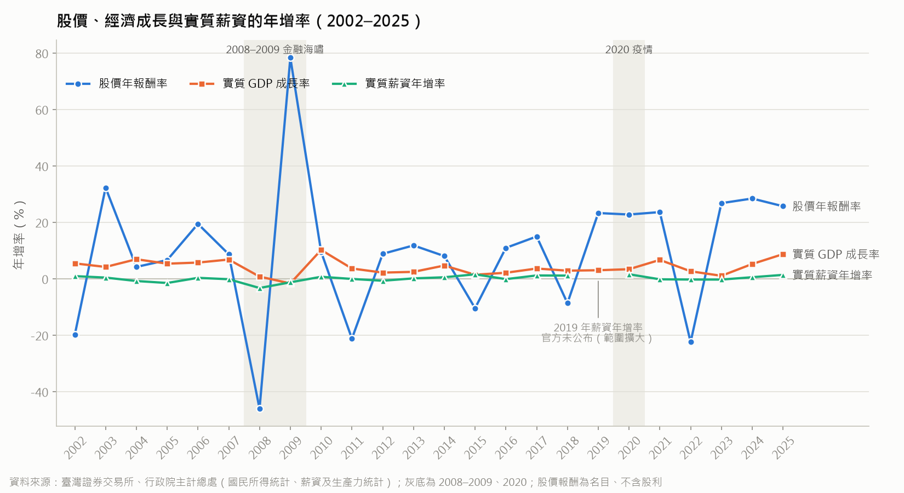
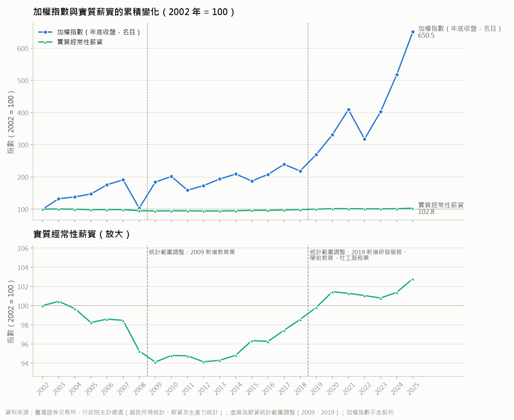
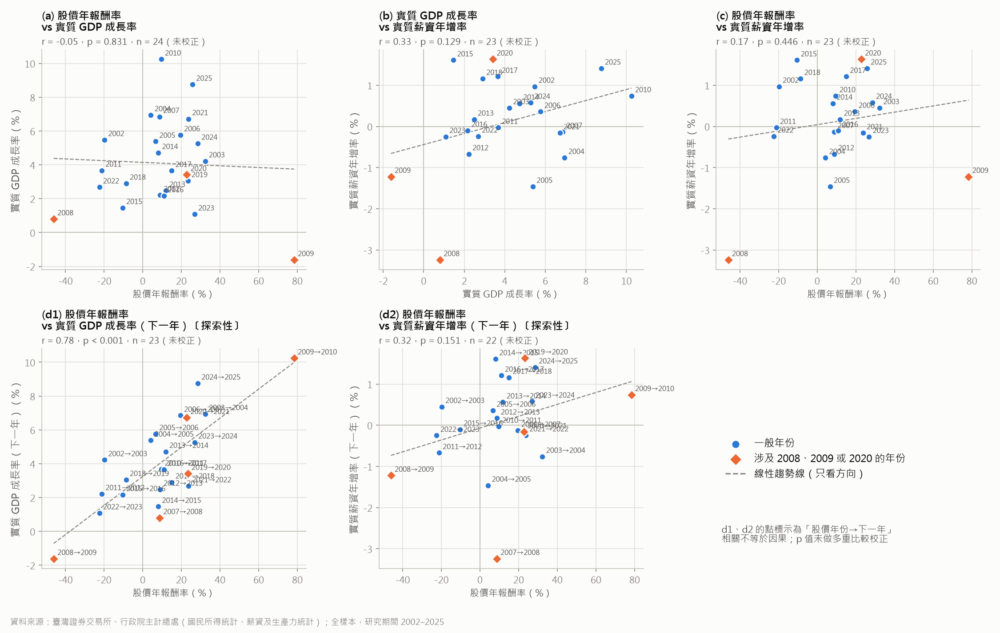

# 長期分析結果摘要（2002–2025）：股市上漲是否代表整體經濟變好？

- 資料：`data/clean/annual_long.csv`；研究期間 **2002–2025 年（24 個年度）**，2001 年只當基期，不納入任何統計
- 程式：`analysis/analysis_long.py`（執行：`uv run python analysis/analysis_long.py`）
- 圖表與表格：`analysis/output_long/`（原本 2015–2025 年的 `analysis/output/` 未更動）
- 本摘要的數字來自 2026-11-03 的執行結果；原始資料更新後請重新執行並核對。

## 閱讀前先知道的限制（適用於以下每一項發現）

1. **相關不等於因果。** 本文所有相關係數只描述「兩個數字是否常一起變動」，不能說明誰影響誰，也可能都受第三個因素影響（例如全球景氣、半導體循環、利率）。
2. **樣本很少。** 每組相關只有約 **17–24 個年度**（主表為 22–24 年，排除年份後最少 17 年）。少數極端年份就可能大幅改變結果。
3. **檢定組數很多，需要多重比較校正。** 本分析共做 5 組相關 × 4 種樣本 × 2 種方法（Pearson、Spearman）＝ 40 個檢定。檢定做得越多，單純碰運氣出現「p < 0.05」的機會就越大。表中另外列出 Holm 校正後的 p 值，判讀時請以校正後的 p 值為主。
4. **股價是名目值、不含股利。** 加權指數是價格指數，沒有扣除通膨，也沒有計入現金股利（台股每年股利率約 3%–4%）。所以表中的股價漲幅**不是**投資人的實際報酬，也不能直接和「實質」的 GDP、薪資比大小。
5. **薪資是「經常性薪資」，不含獎金。** 年終獎金、績效獎金、員工分紅都不在內。景氣好的年份獎金通常增加較多，所以本資料可能低估受薪者總所得的變動。
6. **薪資統計範圍在 2009 年、2019 年各調整一次**（2009 新增教育業；2019 新增研究發展服務業、學前教育、社會工作服務業）。2019 年的官方年增率因此空白，相關分析中凡是用到 2019 年薪資年增率的年份都已排除。

## 描述統計（2002–2025）

| 變數 | 年數 | 平均 | 標準差 | 最低（年） | 最高（年） | 負值年數 |
|------|-----|------|--------|-----------|-----------|---------|
| 股價年報酬率（%，名目、不含股利） | 24 | 9.85 | 24.27 | −46.03（2008） | 78.34（2009） | 6 |
| 實質 GDP 成長率（%） | 24 | 4.10 | 2.68 | −1.61（2009） | 10.25（2010） | 1 |
| 實質薪資年增率（%） | 23 | 0.11 | 1.12 | −3.24（2008） | 1.63（2020） | 11 |

股市每年的波動遠大於經濟成長，經濟成長的波動又大於實質薪資。實質經常性薪資在 23 個有數字的年度中，有 11 年是負成長。

## 發現 1：三條年增率走勢差很多（圖 1）

- **2008–2009 金融海嘯**：股市 2008 年跌 46%，2009 年又大漲 78%。經濟成長在 2009 年轉負（−1.6%），實質薪資則在 2008、2009 兩年都是負的。這兩年是整段期間最極端的值，對相關係數的影響很大（見發現 4）。
- **2020 疫情**：股市漲 22.8%，經濟成長 3.4%，實質薪資增加 1.63%（整段期間最高）。這一年三者都是正的，並不是「衰退年」。
- 其他年份，股市大起大落，經濟成長大多在 1%–7% 之間，實質薪資大多在 ±1.5% 之間小幅變動。

## 發現 2：股市的累積漲幅遠大於實質薪資（圖 2）

以 2002 年 = 100：2025 年加權指數為 **650.5**，實質經常性薪資為 **102.8**。

- 實質經常性薪資 2002–2009 年大致往下走（最低約 94），2013 年後才慢慢回升，直到 **2019–2020 年才回到 2002 年的水準**。
- 圖中虛線標示 2009、2019 兩次統計範圍調整。跨過這兩條線時，前後的薪資數字涵蓋的行業不完全相同，比較時要小心（分段數字見發現 5）。
- 提醒：加權指數是名目值、不含股利，薪資是扣除物價後的實質值，兩條線的「高度差」包含了通膨，不能全部解讀為股市與薪資的差距。

## 發現 3：同一年的相關，三組都不顯著（圖 3a–3c）

| 組別 | 變數 | n | 排除年份 | Pearson r | p 值 | Holm 校正 p（5 組） | Spearman ρ | Spearman p |
|------|------|---|---------|-----------|------|------------------|-----------|-----------|
| a | 股價報酬 vs 同年 GDP 成長 | 24 | — | −0.05 | 0.831 | 0.893 | 0.05 | 0.818 |
| b | GDP 成長 vs 實質薪資年增率 | 23 | 2019（官方缺值） | 0.33 | 0.129 | 0.518 | 0.24 | 0.266 |
| c | 股價報酬 vs 實質薪資年增率 | 23 | 2019（官方缺值） | 0.17 | 0.446 | 0.893 | 0.13 | 0.550 |

白話說明：

- **(a) 股市和同一年的經濟成長**：幾乎沒有相關（r ≈ 0）。只看同一年，「股市漲」和「經濟成長快」並沒有一起出現的傾向。
- **(b) 經濟成長和實質薪資**：有一點正相關，但不顯著；而且這個正相關主要來自 2008–2009 年（經濟和薪資同時變差）。排除這兩年後，r 降到 0.02，幾乎消失。
- **(c) 股市和實質薪資**：相關很弱，也不顯著。排除 2008、2009、2020 三年後 r 約為 0。

在這 23–24 年的資料裡，看不出「股市漲的年份，經濟成長或實質薪資也跟著比較好」。但樣本少、檢定力（偵測到中等程度關係的能力）不高，所以這只代表「沒有找到證據」，**不等於證明兩者無關**。

## 發現 4：穩健性檢查（排除特殊年份、改用 Spearman）

完整數字見 `output_long/robustness.csv`（20 列，每列都有 Pearson 和 Spearman 的結果，以及 Holm 校正後的 p 值）。重點如下：

| 組別 | 全樣本 r | 排除 2008–2009 | 排除 2020 | 排除三年 | Spearman ρ（全樣本） |
|------|---------|---------------|----------|---------|---------------------|
| a 股價 vs GDP | −0.05（n=24） | 0.18（n=22） | −0.04（n=23） | 0.20（n=21） | 0.05 |
| b GDP vs 薪資 | 0.33（n=23） | 0.02（n=21） | 0.36（n=22） | 0.07（n=20） | 0.24 |
| c 股價 vs 薪資 | 0.17（n=23） | 0.04（n=21） | 0.14（n=22） | −0.03（n=20） | 0.13 |
| d1 股價 vs 下一年 GDP〔探索性〕 | 0.78（n=23） | 0.60（n=20） | 0.79（n=21） | 0.62（n=18） | 0.67 |
| d2 股價 vs 下一年薪資〔探索性〕 | 0.32（n=22） | 0.26（n=19） | 0.30（n=20） | 0.23（n=17） | 0.39 |

- a、b、c 三組在任何一種樣本下都不顯著（未校正的 p 值也都大於 0.10），結論方向一致：**同一年的關係很弱**。
- 排除 2008–2009 對 b 的影響最大，表示 b 的弱正相關主要靠金融海嘯那兩年撐起來。
- 排除 2020 年對所有組別的影響都很小。
- d1、d2 做「下一年」比較時，只要股價年份（t）或下一年（t+1）落在排除的年份，就拿掉那一組。所以「排除 2008–2009」實際拿掉 2007→2008、2008→2009、2009→2010 三組；「排除 2020」實際拿掉 2019→2020、2020→2021 兩組。

## 發現 5：累積變化與年複合成長率

### 2002–2025 年（23 年）

| 變數 | 累積變化 | 年複合成長率 | 算法 |
|------|---------|-------------|------|
| 加權指數（年底收盤，名目、不含股利） | +550.5% | 8.48% | 2025 年底收盤 ÷ 2002 年底收盤 |
| 實質 GDP | +146.7% | 4.00% | 2003–2025 年經濟成長率連乘 |
| 實質經常性薪資 | +2.8% | 0.12% | 2025 年統計值 ÷ 2002 年統計值（跨兩次範圍調整） |

23 年間，實質 GDP 大約變成 2.5 倍，但實質經常性薪資只增加不到 3%。這是本分析中最清楚、也最不依賴統計檢定的結果：**經濟規模的成長，大部分沒有反映在受僱者的實質經常性薪資上**。不過這是描述性比較，不能說明原因（可能和產業結構、獎金占比、勞動份額、統計範圍等有關，本資料無法區分）。

### 實質薪資：2009、2019 兩個斷點前後

| 期間 | 年數 | 實質薪資累積變化 | 年複合成長率 | 統計範圍 |
|------|-----|----------------|-------------|---------|
| 2002–2008 | 6 | −4.72% | −0.80% | 調整前，一致 |
| 2008→2009 | 1 | −1.22% | — | **跨 2009 調整，前後範圍不同** |
| 2009–2018 | 9 | +4.73% | +0.51% | 兩次調整之間，一致 |
| 2018→2019 | 1 | +1.27% | — | **跨 2019 調整，前後範圍不同** |
| 2019–2025 | 6 | +2.99% | +0.49% | 2019 調整後，一致 |

同一段期間的股價與實質 GDP（對照用）：

| 期間 | 加權指數（名目） | 實質 GDP |
|------|----------------|---------|
| 2002–2008 | +3.1%（年複合 0.51%） | +33.8%（年複合 4.98%） |
| 2009–2018 | +18.8%（年複合 1.93%） | +38.6%（年複合 3.70%） |
| 2019–2025 | +141.4%（年複合 15.82%） | +31.2%（年複合 4.62%） |

- 在統計範圍一致的三段裡，實質薪資的年複合成長率都在 −0.8% 到 +0.5% 之間，三段都遠低於同期的實質 GDP 成長。
- 跨斷點的兩年（2008→2009、2018→2019），前後的行業範圍不同，數字混合了「真實變化」與「範圍調整」，不宜單獨解讀。
- 股價的分段數字很受起點和終點影響。例如 2002–2008 年的終點剛好是金融海嘯低點，所以只有 +3.1%。分段比較股價時要特別小心。

## 發現 6（探索性）：股市和「下一年」的經濟成長

**這一項是探索性分析，只能當作值得後續研究的線索，不能當作結論。**

- **(d1) 今年股價報酬 vs 下一年經濟成長**：全樣本 r = 0.78（n = 23，未校正 p < 0.001；5 組 Holm 校正後 p < 0.001；Spearman ρ = 0.67）。
- 但這個結果很依賴 2008–2009 年：2008 年股市大跌、2009 年經濟負成長；2009 年股市大漲、2010 年經濟成長 10%。排除這幾組後，r 降到 0.60（n = 20，未校正 p = 0.005）。若再把全部 20 個 Pearson 檢定一起做 Holm 校正，p ≈ 0.09，**就不再顯著**。排除三年時 r = 0.62（n = 18），校正後 p ≈ 0.11。
- **(d2) 今年股價報酬 vs 下一年實質薪資年增率**：r = 0.32（n = 22，p = 0.151），不顯著；排除特殊年份後更弱。

可以怎麼理解：股市常被認為會「提前反映」景氣，d1 的結果和這個說法方向一致。但目前的證據主要來自金融海嘯這一次大事件，加上樣本只有約 20 年、檢定組數多，**不足以斷定股市能預測下一年的經濟成長**，更不能說股市「造成」下一年的成長。對薪資則沒有看到類似的關係。

## 總結

1. 2002–2025 年間，**同一年**的股價報酬和經濟成長、實質薪資都沒有顯著相關。不論是否排除 2008–2009、2020，或改用 Spearman，結果都一樣。
2. 長期來看，股價（名目、不含股利）漲到約 6.5 倍，實質 GDP 約 2.5 倍，實質經常性薪資只增加約 3%。「經濟成長」和「受薪者經常性薪資」之間的落差，比「股市」和「經濟」之間的落差更明顯。
3. 股市和**下一年**經濟成長的正相關是探索性發現，主要受金融海嘯影響，經多重比較校正並排除特殊年份後就不顯著，只能當作線索。
4. 以上都是相關分析，不代表因果；樣本約 23–24 年（排除後最少 17 年）；股價為名目值、不含股利；薪資是經常性薪資、不含獎金。

## 輸出檔案

| 檔案 | 內容 |
|------|------|
| `summary.md` | 本摘要 |
| `fig1_trend.png` | 三條年增率趨勢圖，灰底標示 2008–2009 與 2020 |
| `fig2_index_2002_100.png` | 2002 = 100 標準化指數（上：加權指數與實質薪資；下：薪資放大，標示 2009、2019 統計範圍調整） |
| `fig3_scatter.png` | 五組相關的散布圖（全樣本），涉及 2008、2009、2020 的點另外標色 |
| `correlations.csv` | 主表：五組全樣本相關（Pearson、Spearman、n、p 值、5 組 Holm 校正 p） |
| `robustness.csv` | 穩健性表：五組 × 四種樣本，含實際排除的年份與 20 個 Pearson 檢定的 Holm 校正 p |
| `cumulative_cagr.csv` | 累積變化與年複合成長率（主表、薪資斷點、分段對照） |
| `index_2002_100.csv` | 標準化指數數值 |
