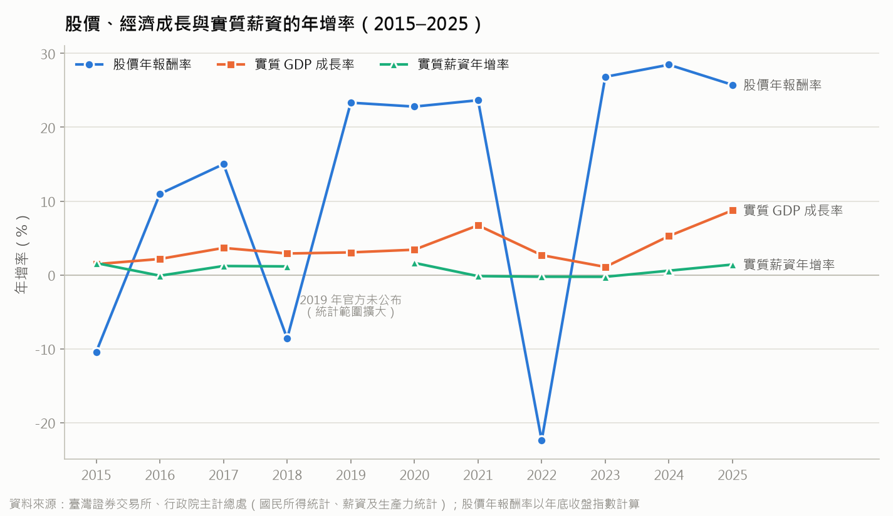
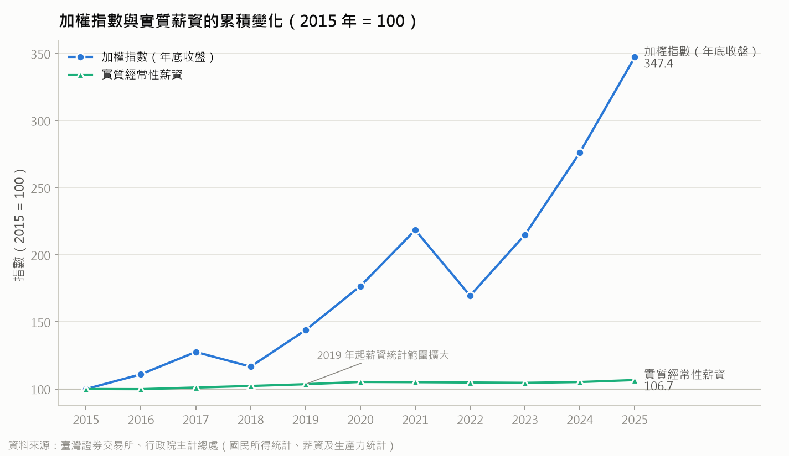
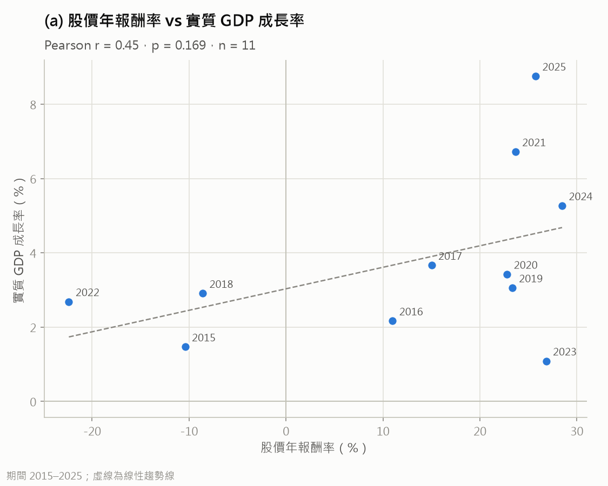
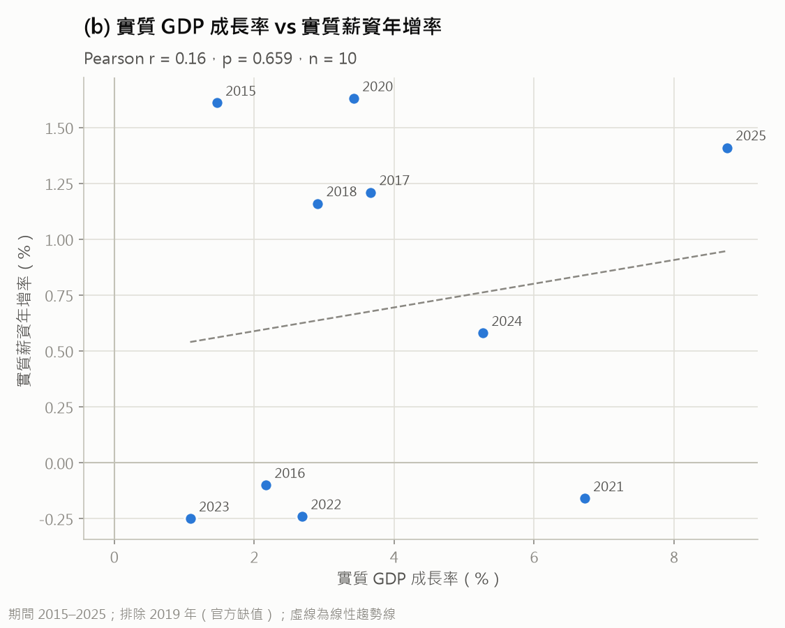
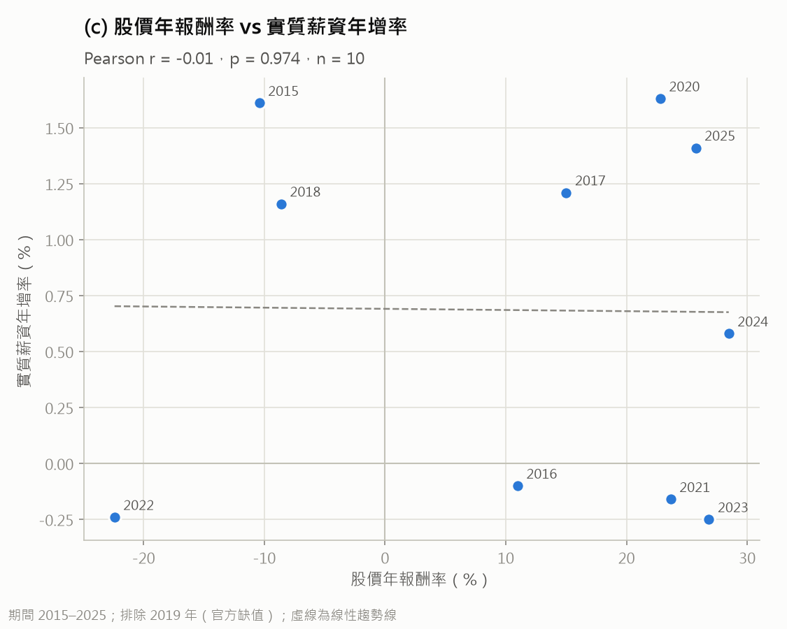
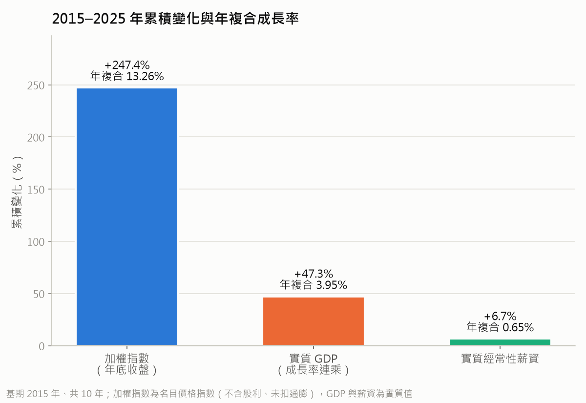

# 分析結果摘要：股市上漲是否代表整體經濟變好？

- 資料：`data/clean/annual_2014_2025.csv`，分析期間 2015–2025 年
- 程式：`analysis/analysis.py`（執行：`uv run python analysis/analysis.py`）
- 圖表與表格：`analysis/output/`
- 本摘要的數字來自 2026-11-03 的執行結果；若原始資料更新，請重新執行程式並核對數字。

## 一句話結論

2015–2025 年間，台股漲了約 2.5 倍，但實質經常性薪資只增加約 7%。三組相關係數都**未達統計顯著**：股市和經濟成長大致同方向但關係不穩定，股市和實質薪資則幾乎沒有關係。在這 11 年裡，「股市上漲」並不能代表「受薪者的薪水跟著變好」。

探索性的補充分析發現，股市和**下一年**的經濟成長有較強的正相關（r = 0.70，p = 0.026），但樣本很小，而且結果很依賴個別年份，只能當作線索。

## 描述統計（2015–2025）

| 變數 | 年數 | 平均 | 標準差 | 最低（年） | 最高（年） |
|------|-----|------|--------|-----------|-----------|
| 股價年報酬率（%） | 11 | 12.31 | 17.83 | −22.40（2022） | 28.47（2024） |
| 實質 GDP 成長率（%） | 11 | 3.74 | 2.31 | 1.08（2023） | 8.76（2025） |
| 實質薪資年增率（%） | 10 | 0.68 | 0.81 | −0.25（2023） | 1.63（2020） |

股市的波動遠大於經濟成長，經濟成長的波動又大於實質薪資。

## 發現 1：三條年增率的走勢差很多（圖 1）



- **股市**大起大落：有 3 年下跌（2015 −10.4%、2018 −8.6%、2022 −22.4%），其餘年份多在 +10% 到 +28% 之間。
- **經濟成長**每年都是正的，但股市下跌的那 3 年，經濟成長仍有 1.5%–2.9%，經濟並沒有跟著衰退。
- **實質薪資**大多在 −0.3% 到 +1.6% 之間小幅變動，其中 4 年是負的（2016、2021、2022、2023）。
- 最明顯的背離是 **2023 年**：股市漲 26.8%，經濟成長只有 1.1%，實質薪資還減少 0.25%。**2021 年**也類似：股市漲 23.7%、經濟成長 6.7%，實質薪資卻減少 0.16%。

## 發現 2：股市的累積漲幅遠遠超過實質薪資（圖 2）



以 2015 年 = 100：

| 年 | 加權指數 | 實質經常性薪資 |
|----|---------|---------------|
| 2015 | 100.0 | 100.0 |
| 2018 | 116.7 | 102.3 |
| 2019 | 143.9 | 103.6 |
| 2022 | 169.6 | 104.9 |
| 2025 | **347.4** | **106.7** |

- 十年間加權指數漲到約 3.5 倍，實質經常性薪資只增加 6.7%。
- 因為 2019 年薪資統計範圍有調整，也可以分兩段來看：2015–2018 年實質薪資增加 2.3%；2019–2025 年增加 3.0%，同一期間加權指數則上漲約 141%。不論用哪一段，兩者的差距都很大。

## 發現 3：相關係數（圖 3a–3c）

| 組別 | 變數 | n | 排除年份 | Pearson r | p 值 |
|------|------|---|---------|-----------|------|
| a | 股價年報酬率 vs 實質 GDP 成長率 | 11 | — | 0.446 | 0.169 |
| b | 實質 GDP 成長率 vs 實質薪資年增率 | 10 | 2019 | 0.160 | 0.659 |
| c | 股價年報酬率 vs 實質薪資年增率 | 10 | 2019 | −0.012 | 0.974 |

（完整數字見 `output/correlations.csv`）

**白話說明**

- **(a) 股市與經濟成長：中度正相關，但不顯著。** 股市漲得多的年份，經濟成長通常也比較高（例如 2021、2024、2025），但例外很多：2023 年股市大漲、經濟成長卻是十年最低；2022 年股市大跌，經濟仍成長 2.7%。p = 0.169，代表這樣的相關程度很可能只是巧合。

  

- **(b) 經濟成長與實質薪資：幾乎無關。** r = 0.16 很接近 0。經濟成長高的 2021 年（6.7%），實質薪資反而減少；經濟成長最低的 2015 年（1.5%），實質薪資卻增加 1.6%。經濟成長沒有穩定地反映在實質薪資上。

  

- **(c) 股市與實質薪資：完全沒有關係。** r = −0.01，趨勢線幾乎是水平的。股市大漲的年份，實質薪資有時增加（2020、2025）、有時減少（2021、2023）；股市下跌的年份（2015、2018）實質薪資反而增加。

  

**關於顯著性**：樣本這麼小，相關係數要很大才會顯著。在 5% 顯著水準下，n = 11 時 |r| 大約要超過 0.60，n = 10 時大約要超過 0.63，三組都沒有達到。

## 補充分析（探索性）

> 以下兩項是**探索性分析**，不是事先設定的研究假設。樣本只有 9–10 個年度，結果只能當作「值得進一步研究的線索」，不能當成結論。

### 補充 1：累積變化與年複合成長率（圖 4）



| 變數 | 期間 | 累積變化 | 年複合成長率（CAGR） | 算法 |
|------|------|---------|---------------------|------|
| 加權指數（年底收盤，名目） | 2015–2025（10 年） | +247.4% | 13.26% | 2025 年底收盤 ÷ 2015 年底收盤 |
| 實質 GDP | 2015–2025（10 年） | +47.3% | 3.95% | 2016–2025 成長率連乘 |
| 實質經常性薪資 | 2015–2025（10 年） | +6.7% | 0.65% | 2025 年統計值 ÷ 2015 年統計值 |
| 實質經常性薪資（補充） | 2019–2025（6 年） | +3.0% | 0.49% | 2025 年統計值 ÷ 2019 年統計值 |

（完整數字見 `output/cumulative_cagr.csv`）

**算法說明**

- **基期**：和圖 2 一樣以 2015 年為基期、2025 年為終點，中間共 10 年。
- **加權指數、實質薪資**：資料本身就是水準值，所以直接把終點值除以基期值。
- **實質 GDP**：資料只有每年的成長率，沒有 GDP 金額，所以把成長率一年一年連乘：

  ```
  累積倍數 = (1 + g2016/100) × (1 + g2017/100) × … × (1 + g2025/100)
  ```

  得到的結果等於「2025 年實質 GDP ÷ 2015 年實質 GDP」。2015 年本身的成長率是 2014→2015 的變化，在基期之前，所以不列入。
- **年複合成長率**：CAGR = 累積倍數^(1/年數) − 1，意思是「如果每年都用同樣的速度成長，平均每年要成長多少，才會得到這個累積結果」。
- **補充列**：2019 年薪資統計範圍有調整，所以另外算一段範圍一致的 2019–2025 年。同一期間加權指數上漲約 141%，差距一樣很大。

**白話說明**

這 10 年整體經濟（實質 GDP）大約成長了一半，平均每年約 4%；股市漲到原來的 3.5 倍左右，平均每年約 13%；實質經常性薪資只增加約 7%，平均每年不到 0.7%。也就是說，**經濟有成長，但薪資的成長遠遠落後經濟成長，更落後股市**。

**注意**：這三個數字不是用同一把尺量的。

- 加權指數是**名目**價格指數，沒有扣掉通膨。本研究沒有物價資料，所以無法精確扣除通膨。扣掉通膨後股市漲幅會小一些，但這段期間台灣的物價漲幅遠小於股市的 247%，所以結論不會改變。如果需要精確的實質股價，可以再補主計總處的消費者物價指數（CPI）。另外，加權指數不含股利，若把股利算進去，股市的報酬會更高。
- GDP 是整體經濟的規模，薪資是「每人」每月的薪資。兩者範圍不同，GDP 成長有一部分可能流向企業利潤、資本所得或獎金分紅，而不是經常性薪資。

### 補充 2：領先落後——股市是否「預告」下一年的經濟與薪資？

股市常被認為會提前反映對未來的預期，所以這裡比較「今年的股價報酬」和「下一年的 GDP 成長率、實質薪資年增率」。

| 股價年報酬率（第 t 年）vs | 對照年 | 第 t 年的範圍 | 排除 | n | Pearson r | p 值 |
|--------------------------|-------|--------------|------|---|-----------|------|
| 實質 GDP 成長率 | 同一年（t） | 2015–2025 | — | 11 | 0.446 | 0.169 |
| 實質 GDP 成長率 | **下一年（t+1）** | 2015–2024 | — | 10 | **0.695** | **0.026** |
| 實質薪資年增率 | 同一年（t） | 2015–2025 | 2019 | 10 | −0.012 | 0.974 |
| 實質薪資年增率 | **下一年（t+1）** | 2015–2024 | 2018 | 9 | 0.473 | 0.199 |

- 「同一年」兩列和前面的 (a)、(c) 相同，放在一起方便比較。
- 薪資「下一年」排除 2018 年，因為對應的 2019 年實質薪資年增率是官方缺值。
- 2025 年沒有下一年的資料，所以不列入「下一年」的計算。

（完整數字見 `output/lead_lag.csv`）

**白話說明**

- **股市與下一年的經濟成長**：相關係數從同一年的 0.45 提高到 0.70，p = 0.026，是本研究**唯一達到 5% 顯著水準**的結果。也就是說，股市漲得多的年份，**隔年**的經濟成長往往比較高。例如 2024 年股市漲 28.5%，2025 年經濟成長 8.8%；2022 年股市跌 22.4%，2023 年經濟成長只有 1.1%。這和「股市會提前反映未來景氣」的說法相符。
- **股市與下一年的實質薪資**：相關係數從同一年的 −0.01 提高到 0.47，但仍不顯著（p = 0.199）。就算考慮時間差，股市和實質薪資的關係依然很弱。

**為什麼這個顯著結果要保守看待**

1. **很依賴個別年份**：每次拿掉一年重新計算（leave-one-out），r 介於 0.60 到 0.78 之間，方向很穩定。但如果拿掉 2022 年，p 會變成 0.088；拿掉 2015 年，p 會變成 0.051，就不顯著了。也就是說，顯著與否取決於少數幾年。
2. **改用等級相關，結果相近**：Spearman ρ = 0.70，p = 0.025。這表示結果不是被某個極端值「拉」出來的，但樣本依然很小。
3. **檢定做了很多次**：本摘要一共做了 5 組不同的相關檢定（(a)(b)(c) 加上兩組領先落後）。檢定次數多，就算變數之間其實沒有關係，也比較容易「碰巧」出現一個顯著結果。如果用較嚴格的 Bonferroni 校正（0.05 ÷ 5 = 0.01），p = 0.026 就不算顯著了。
4. 這項分析是看完同期結果後才加做的，屬於探索性分析，需要更長的期間或季資料才能確認。

## 回答研究問題

1. **股市與經濟成長是否同方向變動？** 同一年大致同方向（r = 0.45），但不顯著，而且有明顯的例外年份（2022、2023）。如果拿股市和下一年的經濟成長比較，相關性比較強（r = 0.70），但這是探索性結果，見補充 2。
2. **股市與實質薪資是否同方向變動？** 沒有。同一年的相關係數接近 0，就算考慮一年時間差也不顯著。10 年來實質薪資平均每年只成長 0.65%，股市則是 13.26%。
3. **三者在哪些年份同步、哪些年份背離？**
   - 同時往好的方向走：2017、2020、2024、2025（股市上漲、經濟成長，實質薪資也增加）。
   - 明顯背離：2021、2023（股市大漲，實質薪資卻減少）；2015、2018（股市下跌，實質薪資卻增加）。
   - 從累積變化來看，股市的漲幅遠遠超過實質薪資。

## 研究限制

1. **樣本很小**：只有 11 個年度（扣掉 2019 年後是 10 個），統計檢定的檢定力很低。「不顯著」不代表「確定沒有關係」，只代表這些資料不足以證明有關係。只要 1、2 個極端年份（例如 2022、2023）有變化，結果就可能明顯不同。
2. **相關不等於因果**：就算看到相關，也不能推論是「股市帶動經濟」或「經濟帶動股市」，可能是第三個因素（例如全球景氣、半導體產業循環、利率）同時影響兩者。本研究沒有控制其他變數。
3. **2019 年實質薪資年增率缺值**：官方因為行業範圍擴大，沒有公布 2019 年和 2018 年的比較值。本研究照官方做法留空，相關分析 (b)、(c) 排除該年，n = 10，沒有自行補值。
4. **2019 年薪資統計範圍有調整**：從 2019 年 1 月起，薪資統計新增研究發展服務業、學前教育、社會工作服務業。因此 2018 和 2019 年的薪資**水準**不能直接比較，圖 2 跨越 2019 年的累積變化也要保守解讀。
5. **時間基準不一致**：股價年報酬率是用「年底收盤」這一個時間點計算，GDP 成長率和實質薪資則是「全年」的平均或總量。股市通常會提前反映對未來的預期，所以同一年的數字對不上，不一定代表兩者無關，也可能是時間差造成的。

其他需要注意的地方：

- **加權指數是價格指數**，不含股利再投入，所以會低估股票投資人實際拿到的報酬。另外，加權指數集中在少數大型電子股，漲幅不代表多數產業。
- **經常性薪資不含獎金與分紅**，股市好的年份如果主要是靠年終獎金、員工分紅讓收入增加，經常性薪資就反映不出來。
- **2025 年的 GDP 與薪資可能還是初步統計**，之後官方修正時，需要重新下載並執行程式。

## 產出檔案

| 檔案 | 內容 |
|------|------|
| `output/fig1_trend.png` | 三個年增率的趨勢圖 |
| `output/fig2_index_2015_100.png` | 加權指數與實質薪資的標準化指數圖（2015 = 100） |
| `output/fig3a_scatter_taiex_return_vs_gdp_growth.png` | 散布圖 a |
| `output/fig3b_scatter_gdp_growth_vs_real_wage_growth.png` | 散布圖 b |
| `output/fig3c_scatter_taiex_return_vs_real_wage_growth.png` | 散布圖 c |
| `output/fig4_cumulative_cagr.png` | 累積變化與年複合成長率長條圖 |
| `output/correlations.csv` | 相關係數表（r、p、n、排除年份） |
| `output/index_2015_100.csv` | 標準化指數數值 |
| `output/cumulative_cagr.csv` | 累積變化與 CAGR 表（含算法說明） |
| `output/lead_lag.csv` | 領先落後相關表（含 Spearman 與 leave-one-out 穩健性檢查） |
